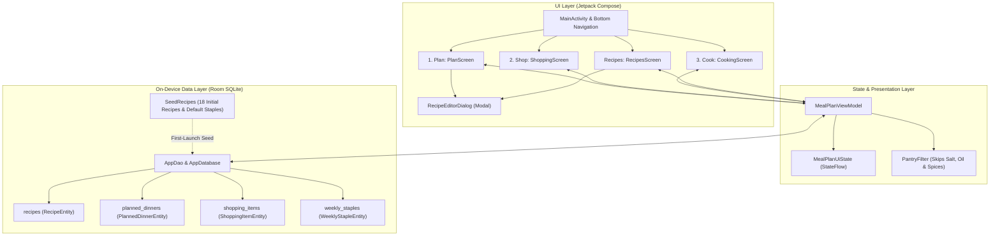

# Developer Guide — My Week to Cook

This document covers local build and installation instructions, tech stack details, and the application layout for **My Week to Cook**. For an end-user guide on app navigation and meal-planning workflows, see **[README.md](./README.md)**.

---

## Tech Stack

- **Language**: Kotlin 2.0 (JVM Target 17)
- **UI Framework**: Jetpack Compose with Material 3
- **Architecture**: MVVM (`MealPlanViewModel` + reactive `StateFlow` UI state)
- **On-Device Persistence**: Room (SQLite) with KSP annotation processing
- **Minimum SDK**: API 26 (Android 8.0) / **Target & Compile SDK**: API 34 (Android 14)

---

## Application Layout & Architecture

The diagram below outlines how the UI navigation tabs, ViewModel state, Room database entities, and domain utilities fit together:



### Source Directory Structure

```text
app/src/
├── main/
│   ├── AndroidManifest.xml
│   ├── java/com/myweektocook/
│   │   ├── MainActivity.kt                  # App entry point, scaffold & bottom navigation
│   │   ├── MyWeekToCookApp.kt               # Application class
│   │   ├── data/
│   │   │   ├── AppDao.kt                    # Room DAO queries & reactive Flows
│   │   │   ├── AppDatabase.kt               # Room database singleton
│   │   │   ├── Models.kt                    # Entities, ProteinType, TypeConverters & PantryFilter
│   │   │   └── SeedRecipes.kt               # Initial recipes from recipes.md & weekly staples
│   │   └── ui/
│   │       ├── MealPlanViewModel.kt         # State management across Plan, Shop, Cook & Recipes
│   │       ├── components/
│   │       │   └── RecipeEditorDialog.kt    # Add/Edit dialog for trial & permanent recipes
│   │       ├── screens/
│   │       │   ├── PlanScreen.kt            # Phase 1: Weekly dinner & side planning
│   │       │   ├── ShoppingScreen.kt        # Phase 2: Reorderable grocery list & staples
│   │       │   ├── CookingScreen.kt         # Phase 3: Toggleable ingredients & step tracker
│   │       │   └── RecipesScreen.kt         # Recipe collection browser & editor
│   │       └── theme/
│   │           └── Theme.kt                 # Material 3 color scheme
│   └── res/
│       └── values/
│           ├── strings.xml
│           └── themes.xml
└── test/
    └── java/com/myweektocook/
        └── MealPlanningLogicTest.kt         # Unit tests for PantryFilter, seed data & converters
```

---

## Building & Installing Locally

### Prerequisites
- **JDK 17** (required for Android Gradle Plugin 8.5+ and Kotlin 2.0)
- **Android Studio** (Koala / Ladybug or newer recommended) with **Android SDK Platform 34** installed
- An Android device (API 26 / Android 8.0+) or an Android Emulator

### Option 1: Build & Run in Android Studio (Recommended)
1. Open **Android Studio** and select **Open**.
2. Choose this repository folder (`/Users/jamardevitt/dev/my-week-to-cook`).
3. Wait for Android Studio to automatically generate `local.properties` and complete the initial **Gradle Sync**.
4. Select a connected Android device or emulator from the top device dropdown and click **Run (`▶`)** to install and launch the `app` configuration.

### Option 2: Build from the Command Line
1. Ensure your Android SDK location is configured via the `ANDROID_HOME` environment variable or in `local.properties` at the project root:
   ```properties
   sdk.dir=/Users/<your-username>/Library/Android/sdk
   ```
2. Build the debug APK using the Gradle Wrapper:
   ```bash
   ./gradlew assembleDebug
   ```
   The compiled APK is output to `app/build/outputs/apk/debug/app-debug.apk`.
3. Install the debug build directly onto a connected device or running emulator:
   ```bash
   ./gradlew installDebug
   ```
4. Run the unit tests:
   ```bash
   ./gradlew testDebugUnitTest
   ```
